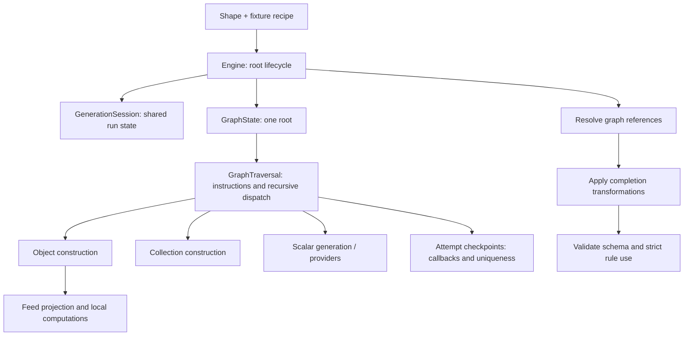

# Architecture and abstraction boundaries

For contributors changing the library. See [Contributing](../../CONTRIBUTING.md) for setup and verification.

The library has five main abstractions. Each has a separate job and state lifetime.

| Abstraction | Responsibility | State lifetime |
| --- | --- | --- |
| `Shape<T>` | Runtime model, constraints, metadata and construction hints | Immutable, reusable |
| `Generator<T>` | Produce one value using a supplied context | Definition reusable; mutable state belongs to execution |
| `Fixture<T>` | Immutable recipe: fields, rules, cases, feeds, computations | Reusable across runs |
| `GenerationSession` | Seed, clock, RNG, counters, feed cursors, defaults, accepted uniqueness keys | One standalone run, batch, stream or explicit session |
| `GraphState` | Root, traversal budget, ancestry, scoped rules, pending effects | One generated root |

Adapters normalize external metadata into shapes. Generators consume execution context. Neither owns the graph traversal lifecycle.

## Instruction and type modules

| Folder | Responsibility |
| --- | --- |
| `core/instructions/` | Runtime generator creation, value/ownership operations, instruction recognition and computed callback registration |
| `core/types/` | Compile-time field overrides, property paths, derived-field types, matching contracts and partial values |
| `core/recipe/` | Recipe and execution option contracts |
| `core/execution/` | Runtime generation, matching and graph/session state |

`core/instructions.ts` re-exports the focused modules. The package entry point preserves the existing public imports. Type utilities emit no runtime code; runtime instructions do not enumerate TypeScript property paths.

Declare each exported interface in its own matching file: `run-options.ts`, `recipe-config.ts`, `generator-context.ts`, `match.ts`, and so on. Re-export files can collect related names for imports. ESLint enforces one exported interface declaration per file and the matching filename throughout library source.

The type modules use named building blocks. `Fields<Order>` checks a partial override tree; `Paths<Order>` describes valid dotted field names; `AtPath<Order, 'customer.name'>` resolves the field's value type. `ValuesAtPaths` preserves callback argument order, and `ComputedFields` checks each computed result against its target property.

Property path enumeration counts visited object levels and defaults to five. This bounds compiler recursion independently of runtime `maxDepth`. Dates, arrays, maps and sets are leaf values, including nullable/optional fields; computations depend on those values as a whole. `leaf-values.ts` centralizes that boundary for overrides, paths and partial values.

## Adapter boundaries

These optional entry points serve different inputs. They do not change the core object-generation API.

| Entry point | Purpose | Internal responsibilities |
| --- | --- | --- |
| `/typescript` | Read an explicitly named TypeScript source declaration | Compiler setup/declaration lookup; cached recursive reader; scalar, union and object conversion |
| `/protobuf` | Convert a protobufjs descriptor into a message-producing shape | Scalar factory table; field/cardinality conversion; recursive message cache, oneof variants and construction |
| `/node` | Prepare feeds/settings and perform explicit filesystem operations | Feed file/stream reading; settings loading; file paths and materialization |

The public files `adapters/typescript.ts`, `adapters/protobuf.ts` and `adapters/node.ts` are small entry points. Their implementation modules live in matching directories. Conversion caches belong to one extraction, so they cannot leak between models. Scalar and built-in collection mappings use factory tables; unions, recursion and oneof composition remain explicit functions.

TypeScript interfaces disappear at runtime, so compiler extraction reads source metadata when you choose it. Explicit shapes need no compiler adapter. Protobuf support is only needed for protobuf messages. The Node entry point keeps async preparation and file writes separate from synchronous generation.

## Execution flow

[`engine.ts`](../../packages/test-data/src/core/engine.ts) coordinates this lifecycle. Field matching, collection generation, feed decoding and scalar algorithms belong to their respective modules.

Traversal uses a named `NodeRequest` containing the shape, path, depth, index, instructions and existing value. Object/collection builders recurse through the small `NodeTraversal` interface rather than reaching into the engine.

## Module ownership

All execution modules live in [`core/execution`](../../packages/test-data/src/core/execution).

| Module | Owns |
| --- | --- |
| `types.ts` | Named traversal/build requests and the recursive traversal interface |
| `session.ts` | Validated execution options, context state and cached kind defaults |
| `graph-state.ts` | Root/ancestry/budgets and access to per-root registries/effects |
| `traversal.ts` | Instruction precedence, wrappers, dispatch, filtering and bounded retries |
| `registry.ts` | Scoped rules, specificity, provider lookup, callback eligibility and strict accounting |
| `objects.ts` | Fields, existing-object population, factories and setters |
| `collections.ts` | Collection size, finite domains, existing elements and distinct entries |
| `scalars.ts` | Built-in leaf generation |
| `feed-projection.ts` | Coherent feed row projection and typed scalar decoding |
| `computed.ts` | Local computed-field dependency ordering |
| `uniqueness.ts` | Shared/composite key domains and provisional reservation journals |
| `effects.ts` | Combined retry checkpoints and completion ordering |
| `references.ts` | Deferred edges and graph identity wiring |

The recipe layer resolves cases and merges typed field instructions before execution. [`fixture-identity.ts`](../../packages/test-data/src/core/fixture-identity.ts) recognizes constructed fixtures through weak registration, so execution does not import the recipe class at runtime. Type-only references preserve declaration types without a runtime dependency cycle.

## State and failure rules

- `one()` starts a session. `many()`, `stream()` and `fixtureRun()` retain its RNG, counters, feed cursors and uniqueness domains.
- Every root creates a new graph state. Scoped rules, providers, callbacks, ancestry and node budgets cannot leak into another root.
- An attempt checkpoint records pending completion calls and provisional uniqueness keys. Rejection rolls both back together.
- A failed root releases its provisional uniqueness keys without releasing keys belonging to previously accepted roots.
- RNG draws, generator state and source cursor consumption advance during attempts; they are not transactional rollback state.
- References resolve before completion. Final schema and strict-use checks run after completion.
- Field overrides retain precedence over feeds/rules. Factory ownership, population policy and initialized-value preservation remain explicit.

These lifetimes matter more than file size: putting counters in graph state would reset sequences on every root; putting rule registries in session state would leak customization across recipes.

## Where to make changes

| Change | Starting point |
| --- | --- |
| Add a standalone value generator | `generators/`; consume `GeneratorContext` |
| Apply application-specific value rules | Application-owned generators supplied through `fields` or providers |
| Add a new scalar runtime kind | Shape/validation contracts, `scalars.ts`, and relevant adapters |
| Change path matching or rule precedence | `path.ts` and `registry.ts` |
| Change retries or uniqueness | `traversal.ts`, `uniqueness.ts` and `effects.ts` |
| Change class/fill behavior | `objects.ts` |
| Change collection sizing or identity | `collections.ts` |
| Add a source format | `feeds/`; preserve row projection in `feed-projection.ts` |
| Add external schema metadata | `adapters/`; normalize into existing shapes |
| Change runner lifecycle | Optional runner adapters; use `fixtureRun()` |

Keep algorithms beside their owners. Add shared infrastructure only when more than one owner needs it; avoid base classes or a plugin container for these synchronous internal collaborators.

## Verification

[Execution boundary tests](../../packages/test-data/test/execution.test.ts) exercise seeded output, session advancement, graph isolation, budgets, root context and uniqueness after failure. Existing tests cover nested scopes, identity, cyclic graphs, construction, feed coherence, filters and callback rollback.

`bun run verify` runs type/lint checks, the full test/coverage suite, builds, executable documentation, and installed ESM/CJS/runner consumers. Runtime internals are not public package entry points. Source declaration files may be packaged as dependencies of public types; importing private execution paths is unsupported.
